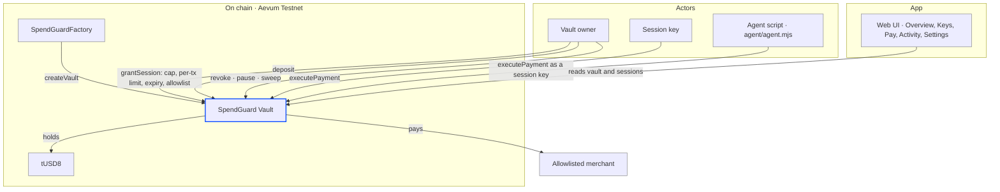

# SpendGuard

**Give an agent a key that can only spend a little, only to approved merchants, only until Friday, and take it back in one click.**

SpendGuard is a scoped session-key vault for tUSD8 on the QDay Aevum testnet (chain 44005), built for the [Aevum Builder Challenge #1](https://dorahacks.io/hackathon/qday/detail). Each user creates their own vault through the SpendGuard factory and owns it outright: they deposit tUSD8 once, then grant session keys to a person, a bot, an AI agent, or a cashier. Each key may spend only within tight, on-chain-enforced bounds: an allowlisted set of recipients, a per-transaction cap, a cumulative spend cap, and an expiry. Every bound is enforced by the contract, not by the frontend. The owner can revoke any key instantly and can always withdraw the remaining balance. Vaults are fully independent: one user's vault can never touch another user's funds. The vault shown on the homepage is the project's demo vault, labelled as such; your vault is yours alone.

Aevum has no session-key tooling yet: the official SDK ships in Q1 2027, and no published bundler, paymaster, or factory is usable by builders today. SpendGuard is that missing piece, implemented natively in Solidity, working on the testnet now with plain wallets.

Spending authority becomes a grantable, revocable, auditable object, not a shared wallet key.

- **Track:** Native AI Assistants (an autonomous agent pays merchants within bounds while the owner watches the audit trail).
- **Status:** contracts + factory + demo agent + full test suite (56 green) + testnet deployment + UI + TypeScript SDK complete and verified (see [ui/VERIFICATION.md](ui/VERIFICATION.md) and [sdk/README.md](sdk/README.md)). Demo video (1m55s, light mode, real on-chain grant, pay, revoke, sweep, plus over-cap and revoked-key reverts) is on YouTube: https://youtu.be/ZwRmUPXpKJ8.
- **Author:** built by Muhammed Adediran ([@Admuad](https://github.com/Admuad)), solo, for the Aevum Builder Challenge #1.
- **Deployed commit:** https://github.com/Admuad/Spendguard/commit/50f965104559c26e61c95713a1ca0f7c3c29de37 (main; this commit deployed the contracts. The live site tracks the current main head.)
- **Live demo:** https://admuad.github.io/Spendguard/ (static export of `ui/`, deployed to the `gh-pages` branch; source of truth is `main`). Mirror: https://spendguard-ivory.vercel.app.
- **Brand:** logo, colors, typography, and usage rules in [BRANDING.md](BRANDING.md).

## How it works

```
Owner ──deposit──> ┌────────────┐
                   │ SpendGuard │──pay──> Allowlisted merchant
Owner ──grant───>  │   Vault    │
                   └────────────┘
                        ▲   │
             revoke / pause │   │ session key calls executePayment
                        │   ▼   │ (caller must BE the key)
                   Owner owns  Agent / bot / cashier
                   recovery    holds ONLY the session key
```



0. **Create.** Call `createVault` on the factory (or click Create vault on the demo page). You own the vault it creates, and its funds are yours alone.
1. **Deposit.** The owner approves exactly the deposit amount and calls `deposit`. The vault pulls exactly that amount. No unlimited approvals anywhere.
2. **Grant.** The owner calls `grantSession` with the session-key address, its recipient allowlist, per-transaction cap, cumulative cap, and expiry. A confirmation summary (key, cap, per-tx, expiry, recipients) is shown before the transaction. Bounds can be edited later with `editSession`, which never resets the amount already spent; the cap can never drop below it. The owner can give the key a name, stored only in the browser, so the sessions list shows what each key is for, how much it has spent, and its share of all spending, most spending first. The deposit form offers 20%, 50%, and Max quick amounts from the wallet balance, and the vault can be topped up as often as the owner likes.
3. **Pay.** The session-key holder calls `executePayment` naming itself, a recipient, and an amount. The contract checks: caller is the key, key is active, not expired, amount within the per-tx and cumulative caps, recipient allowlisted, vault funded, vault not paused. Then it updates accounting *before* the token transfer (checks-effects-interactions) under a reentrancy guard.
4. **Revoke / pause / sweep.** The owner revokes instantly (`revokeSession`), freezes all payments (`pause`, which never blocks the sweep), or recovers everything left (`ownerWithdraw`), in any state, at any time.

Every state change emits an event: the on-chain audit trail.

## Security

The full specification is [THREAT-MODEL.md](THREAT-MODEL.md): 19 invariants, 12 stateful fuzz properties, 15 scripted adversarial tests, 11 accepted risks stated honestly, and the verification items for the tUSD8 token.

Headline guarantees, all proven by the test suite:

- **Bounded delegation.** The maximum loss from any single compromised session key is that key's remaining cap. No failure turns a bounded loss into a vault drain.
- **Instant, irreversible revocation.** Once a revoke is mined, the key can never spend again. Re-granting starts a fresh session with `spent == 0`.
- **Pause freezes spending, never recovery.** The owner sweep works while paused.
- **Token-behavior safe.** Fork-verified 18 Nov 2026: tUSD8 reverts on transfer failure, moves exact amounts, and calls no hooks. Every token move still goes through OpenZeppelin `SafeERC20` as defense-in-depth, and the non-reverting-token tests prove a silent `false` would revert the vault operation and never corrupt cap accounting.
- **Balance-delta deposits.** Deposits credit what actually arrived, so accounting stays correct even if the token ever takes a transfer fee.

Honest limits (see THREAT-MODEL.md §5): the owner key is the root of trust; session state is public on-chain (transparency is the audit trail, no privacy is claimed); mempool front-running of a revoke is bounded by the remaining cap, not preventable.

## Project layout

```
src/
  SpendGuard.sol          # The vault: sessions, caps, allowlist, pause, sweep
  SpendGuardFactory.sol   # One independent vault per user; holds no funds
test/
  SpendGuard.t.sol        # Unit + 15 scripted adversarial tests (T-1..T-15)
  SpendGuardFactory.t.sol # Factory + cross-vault isolation tests (12)
  SpendGuardInvariant.t.sol # Stateful fuzz: 12 invariant properties (P-1..P-12)
  mocks/Mocks.sol         # Plain, non-reverting, and hook tokens + attackers
script/
  Deploy.s.sol            # Testnet vault deploy (env-based, no keys in repo)
  DeployFactory.s.sol     # Testnet factory deploy
agent/                    # Demo agent: pays with ONLY a session key
                          # (see agent/README.md; audit in agent/AGENT-SECURITY.md)
ui/                       # Next.js frontend: live dashboard, deposit, grant,
                          # pay-as-key, revoke, pause/sweep, light/dark themes
                          # (see ui/README.md; verified in ui/VERIFICATION.md)
ARCHITECTURE.md           # Architecture, flows, and API examples
THREAT-MODEL.md           # Security specification and accepted risks
BRANDING.md               # Logo, colors, typography, and usage rules
```

## Try it

No code needed. The live demo is at https://admuad.github.io/Spendguard/.

1. **Install a wallet.** MetaMask, Rabby, or any injected wallet in your browser. No smart account is needed.
2. **Add the Aevum testnet.** Connect your wallet on the demo page and approve the network switch when asked. To add it manually: network name `QDay Aevum Testnet`, chain ID `44005`, RPC `https://rpc-test.qday.info`, explorer `https://explorer-test.qday.info`, currency `tQDAY`.
3. **Claim test tokens.** The [web faucet](https://faucet.qday.info/en) gives 1 tUSD8 per claim with a 24-hour cooldown. The [QDay Discord](https://discord.gg/bYPhjmrSfK) `#faucet` channel gives 1 tQDAY plus 5 tUSD8 once per person.
4. **Create your vault.** Click Create vault. You own the vault it creates; the demo vault on the homepage stays separate and is labelled as a demo.
5. **Deposit.** Approve exactly the amount you want to deposit. Your vault pulls exactly that amount.
6. **Grant a key.** Name the key, its recipients, its per-payment limit, its total cap, and its expiry. The key pays within those bounds. Revoke it in one click at any time.

The same guide is on the demo page, in the Setup section.

## Setup and reproduction

Prerequisites: [Foundry](https://book.getfoundry.sh/) (`forge`, `cast`).

```bash
git clone https://github.com/Admuad/Spendguard.git
cd Spendguard
git submodule update --init   # fetches OpenZeppelin v5.4.0 + forge-std (see .gitmodules)
forge build
forge test      # 56 tests across 3 suites, all green
```

Expected: all green. The invariant suite runs 512 sequences of 64 random operations each (32,768 calls) and asserts all 12 properties.

### Environment variables

| Variable | Purpose |
|---|---|
| `PRIVATE_KEY` | Testnet-only deployer key. Never a mainnet key, never committed. |
| `TUSD8_ADDRESS` | tUSD8 token address on the target chain. |

Copy `.env.example` to `.env` (gitignored) and fill it in. Deploy scripts read the environment only.

### Testnet addresses (chain 44005, Aevum testnet)

| Item | Address |
|---|---|
| tUSD8 (6 decimals) | [`0x456569838f1d43009A91ebA4263147Afd7233483`](https://explorer-test.qday.info/token/0x456569838f1d43009A91ebA4263147Afd7233483) |
| RPC | `https://rpc-test.qday.info` |
| Explorer | `https://explorer-test.qday.info` |
| Demo vault (homepage) | [`0x048a64225419C11C9Ff0CB39aA925902c5e965Ac`](https://explorer-test.qday.info/address/0x048a64225419C11C9Ff0CB39aA925902c5e965Ac) (funded 3.00 tUSD8; 0.10 spent by the LLM agent's live payment, balance 2.90) |
| SpendGuard factory | [`0x3BD7Ffda8504124fb7aE9e28DCA0D01aA5A728EE`](https://explorer-test.qday.info/address/0x3BD7Ffda8504124fb7aE9e28DCA0D01aA5A728EE) |
| Factory deploy tx | [`0x0fde8f6137cd22e71943f91ea110b40c11f5cf6545f88ced29193ff5df276e3a`](https://explorer-test.qday.info/tx/0x0fde8f6137cd22e71943f91ea110b40c11f5cf6545f88ced29193ff5df276e3a) (18 Nov 2026, deployer `0xE5e31bAB0976A568f009980Ed1da2B6A56D8D898`) |
| First factory vault | [`0x048a64225419C11C9Ff0CB39aA925902c5e965Ac`](https://explorer-test.qday.info/address/0x048a64225419C11C9Ff0CB39aA925902c5e965Ac) (the demo vault, created by the deployer wallet; a second vault owned by another address verified isolation live) |

The first deployment (demo vault `0x9a11…` + factory `0x54c6…`) was swept and retired on 18 Nov 2026; the addresses above are the current deployment.

Live end-to-end proof on the testnet (18 Nov 2026, same deployer wallet): deposit 1,000,000 → grant session (cap 800,000, per-tx 400,000) → execute 300,000 → over-cap 500,000 reverted `PerTxLimitExceeded` → non-allowlist recipient reverted `RecipientNotAllowed` → revoke → post-revoke spend reverted `SessionNotActive` → `ownerWithdraw` swept the vault to 0 and the deployer ended back at exactly 6,000,000 tUSD8. Evidence txs: grant [`0xc8827806fd60595f99d3e52b11abd2496bed06c3070a7debb2eb34ced693f1fc`](https://explorer-test.qday.info/tx/0xc8827806fd60595f99d3e52b11abd2496bed06c3070a7debb2eb34ced693f1fc), payment [`0xe3634e7f7d467157fd82ccbbae1fafcb97374fbff3a0b56169badca880e3325f`](https://explorer-test.qday.info/tx/0xe3634e7f7d467157fd82ccbbae1fafcb97374fbff3a0b56169badca880e3325f), revoke [`0x20a6058d105140758cf88c5befb577fda72d3e15cd76350fe42a8c7620e73769`](https://explorer-test.qday.info/tx/0x20a6058d105140758cf88c5befb577fda72d3e15cd76350fe42a8c7620e73769), withdraw [`0x4517d7175503af3de4fe20b2b636657a1d17e76db24eb2af28724ba9c34f37d3`](https://explorer-test.qday.info/tx/0x4517d7175503af3de4fe20b2b636657a1d17e76db24eb2af28724ba9c34f37d3).

### Deploy (testnet only)

```bash
forge script script/DeployFactory.s.sol \
  --rpc-url https://rpc-test.qday.info --broadcast --legacy -vvvv
```

A standalone vault (without the factory) deploys the same way with
`script/Deploy.s.sol`; the deployer becomes its owner.

`--legacy` is deliberate: some tooling mishandles EIP-1559 fields on this chain (starter-kit docs). Both contracts are verified on the explorer (22 Nov 2026, `forge verify-contract` with the Blockscout verifier, solc 0.8.24, EVM shanghai, optimizer 200 runs): factory `0x3BD7Ffda8504124fb7aE9e28DCA0D01aA5A728EE` and demo vault `0x048a64225419C11C9Ff0CB39aA925902c5e965Ac`, both "Pass - Verified". Submission evidence is this repo plus deployment addresses, transaction hashes, and the verified source on the explorer.

### Build constraints that matter on Aevum

- **`evm_version = "shanghai"` is pinned in `foundry.toml`.** Cancun builds deploy and then revert at runtime with `invalid opcode: MCOPY`. No transient storage, no Cancun-only opcodes. The built bytecode is checked for MCOPY before every deploy.
- **No WebSocket RPC; poll over HTTPS.** Any UI built on this vault must poll for confirmations and chunk `eth_getLogs` queries to ≤1,000 blocks per call.
- **Fork chain id 440050 ≠ Aevum 44005.** Signatures are chain-bound; never replay one across them.

## API

All amounts are tUSD8 base units (6 decimals). Full signatures, events, and custom errors: [ARCHITECTURE.md](ARCHITECTURE.md).

| Function | Caller | Effect |
|---|---|---|
| `deposit(uint256 amount)` | Anyone (with approval) | Pulls exactly `amount` into the vault |
| `grantSession(key, recipients, maxPerTx, spendCap, expiresAt)` | Owner | Creates a session key |
| `revokeSession(key)` | Owner | Deactivates a key immediately |
| `executePayment(key, recipient, amount)` | The session key itself | Pays within the key's bounds |
| `ownerWithdraw()` | Owner | Sweeps the full remaining balance |
| `pause()` / `unpause()` | Owner | Circuit breaker (payments only) |
| `getSession(key)` / `isRecipientAllowed(key, recipient)` / `remainingCap(key)` / `vaultBalance()` | Anyone | Views |
| `createVault()` (factory) | Anyone | Deploys a vault owned by the caller, returns its address |
| `vaultsOf(owner)` / `vaultCount()` / `allVaults(i)` (factory) | Anyone | Registry views |

Custom errors are granular (`CapExceeded`, `PerTxLimitExceeded`, `RecipientNotAllowed`, `SessionExpired`, `SessionNotActive`, `CallerNotSessionKey`, …) so a UI can show plain-language explanations instead of raw revert data.

## Known constraints

- **DIY session keys.** QDay's session-key / smart-account infrastructure is announced as live but has no published bundler, paymaster, factory, or SDK addresses usable by builders, and the official SDK ships Q1 2027. SpendGuard therefore implements scoped session keys natively in Solidity. This is the correct and only shippable approach today, and the starter kit's own docs name "a smart account with scoped session keys" as the gap to build. No ERC-4337, ERC-8004, or x402 integration is claimed: none is built, and claiming it would be worse than documenting the DIY design.
- **Public session state.** Caps, recipients, spent amounts, and expiries are readable on-chain. That is the audit trail, not a leak, but no privacy is promised.
- **Single-owner admin.** No multisig, timelock, or upgrade path in this build (see roadmap).
- **Testnet only, test tokens only.** No tokens are issued or promised.

## Reuse

The vault is a single self-contained contract plus standard OpenZeppelin dependencies, and the factory is one more small contract. To create your own vault on the testnet, use the factory on the demo page, no code needed. To deploy your own factory: clone, `forge install`, set `TUSD8_ADDRESS` to your token, run the factory deploy script. To point an agent at a deployed vault, the agent needs only the vault address, its own session-key address, and the `executePayment` ABI. It must never hold the owner key.

## SDK for other builders

The `sdk/` directory is a TypeScript SDK (`spendguard-sdk`, MIT) that wraps the factory and vaults with typed helpers: create a vault, deposit, grant/edit/revoke a session, pay as a session key, pre-flight checks, and chunked history reads. It follows the Aevum rules for you: legacy transactions, the 1,000-block log limit, exact approvals. See `sdk/README.md`. Unit tests run with `npm test`; the live smoke test (`npm run smoke-test`) proved the full flow on the testnet on 21 Nov 2026: fresh vault, deposit 0.10, grant, pay 0.01, over-cap refused, revoke, sweep to zero.

## LLM agent

The `agent/` directory also holds an LLM agent (`llm-agent.mjs`, 11 tests) that turns a plain-language task into a payment. You tell it, in words, what to pay and to whom; the model decides the recipient and amount, the agent validates that decision against the live session limits from the chain, runs the SDK `canSpend` pre-flight, and only then executes the payment through the SDK. The model never touches a key and never moves money by itself. The chain enforces the bounds: if the model picks a recipient outside the allowlist, an amount over the per-payment limit, or anything past the cap, the payment is refused before it is sent.

Proven live on 21 Nov 2026: the agent paid 0.10 tUSD8 to the freelancer for the logo, from the demo vault, within a 1.00 cap. Transaction: https://explorer-test.qday.info/tx/0x96da9c30a0fa510bb57a04f1054e044dd8430b1b8e7c5369a233cb65925b71a4. The default provider is Pollinations, free with no API key; any OpenAI-compatible endpoint works through `LLM_PROVIDER=openai` and `OPENAI_API_KEY`. See `agent/README.md`.

## Go-to-market and path to mainnet

Who this is for: anyone who lets an agent spend money. Agent builders who need their agent to pay merchants without handing it a wallet key. Businesses paying AI agents or contractors for completed work. DAOs and treasuries giving an operator scoped spending power. Cashiers and bots that pay on a schedule. The problem is the same in each case: the spending key must be bounded, revocable, and auditable, and the owner must always be able to take the money back.

How it reaches them: the Aevum mainnet builder program is the first channel. This challenge offers a fast track into it ahead of the mainnet launch in February, and SpendGuard is built to flip from testnet to mainnet without extra building: same contracts, a fresh deployment, the mainnet stablecoin in place of tUSD8. The second channel is the SDK above: other builders adopt the vaults instead of writing their own session-key logic, which makes SpendGuard ecosystem infrastructure, not just one app. The third is the demo itself: a working app, a video, and a README a stranger can follow are the onboarding path.

Monetization, planned not built: the deployed contracts take no fees, and that is deliberate. Trust comes first when you hold other people's money. The fee model for v2 is a small basis-points fee on payments through the factory, or a flat fee per vault creation, charged at the contract level so it cannot be bypassed. A hosted version (vault creation and monitoring without running your own node) and paid integration support for teams are the other two options. None of these is in the deployed contracts today, and none is claimed to be.

What mainnet needs before real money touches it: a third-party audit of the vault and factory, a bug bounty, and a timelock on any fee change. The contracts are written to be auditable (56 Foundry tests, a threat model in THREAT-MODEL.md, 19 numbered invariants), and the testnet deployment is the proof ground for that audit.

## Roadmap

- [x] Testnet deployment (18 Nov 2026) + UI (grant / pay / revoke / pause / sweep + session list with spent-vs-cap bars + audit-trail view), verified at desktop and mobile widths.
- [x] Demo agent script holding only a session key (`agent/`, 66 tests, live-run proven 18 Nov 2026).
- [x] LLM agent (`agent/llm-agent.mjs`, 11 tests): turns a plain-language task into a payment, validated against the live session limits, live-run proven 21 Nov 2026 (0.10 tUSD8 to the freelancer).
- [x] Factory: one vault per user (`SpendGuardFactory`, deployed 18 Nov 2026, 12 isolation tests).
- [x] Demo video against the live deployment (real on-chain grant, pay, revoke, and sweep shown on camera with tx hashes, plus over-cap and revoked-key reverts): https://youtu.be/ZwRmUPXpKJ8.
- [x] TypeScript SDK for other builders (`sdk/`, 11 unit tests, live smoke test passed 21 Nov 2026 on a fresh vault).
- [x] One-click gas funding when granting a key: the owner can also send 0.01 tQDAY to the key (UI checkbox and SDK `grantSession` option `{ fundGas: true }`), so the key can pay for its own gas without a separate manual transfer.
- Multisig owner / timelocked large grants.
- Migration to native ERC-4337 session keys when QDay publishes bundler, factory, and paymaster details (EntryPoint v0.7 is deployed on 44005 but undocumented and unusable without the rest of the stack, a roadmap footnote, not an integration claim).
- No EIP-3009 gasless path: the deployed tUSD8 has no `receiveWithAuthorization`/`transferWithAuthorization` (verified 18 Nov 2026), so no gasless flow via the token is possible. The core vault works without any relayer. EIP-2612 `permit` is present on the token if a signed-approval flow is ever wanted. Until a gasless path exists, the stopgap is one-click gas funding: granting a key can also send it 0.01 tQDAY for gas (shipped in the UI and SDK).

## License

MIT. See [LICENSE](LICENSE).

## Credits

Built by Muhammed Adediran. The contracts and UI are original work. Third-party dependencies: OpenZeppelin Contracts (MIT) for the ERC20 interface, ReentrancyGuard, and Ownable; Foundry for testing; Next.js, wagmi, and viem for the UI. No Aevum Starter Kit code was reused.
